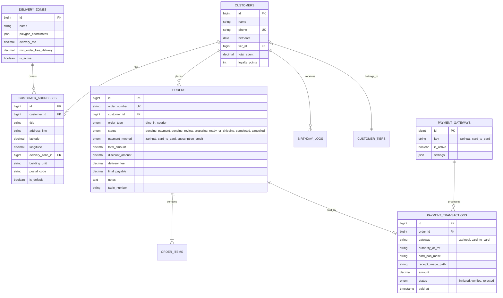

# مستند جامع مشخصات فنی و معماری فاز دوم (Phase 2 Technical Specification)
## سامانه سفارش آنلاین، منوی هوشمند، نقشه نشان، درگاه پرداخت و باشگاه مشتریان پیشرفته
### پلتفرم اختصاصی کافه کراسو / بی کافه (B Cafe - Shiraz)

---

## ۱. خلاصه‌ی مدیریتی و اهداف فاز دوم (Executive Summary)

فاز دوم پروژه **بی کافه (B Cafe)** سیستم مدیریت کافه را از یک پنل داخلی پرسنل به یک **پلتفرم جامع سفارش آنلاین (مشابه اسنپ‌فود اما با هویت بصری لوکس، مینیمال و اختصاصی بی کافه)** توسعه می‌دهد. این سیستم بر بستر همان مونولیت قدرتمند Laravel 12 استوار بوده و سازگاری ۱۰۰٪ با میزبانی cPanel، معماری بدون Worker دائمی (Cron-driven)، کارایی آفلاین صندوق و سرعت لود فوق‌سریع دارد.

### اهداف کلیدی:
1. **منوی آنلاین تعاملی و سفارش‌گیری آنی:** امکان سفارش به دو شیوه **«تحویل حضوری در کافه (Dine-in / Takeaway)»** و **«ارسال با پیک در شیراز (Courier Delivery)»**.
2. **یکپارچه‌سازی نقشه نشان (Neshan Web SDK):** مکان‌یابی دقیق مشتری در سطح کلان‌شهر شیراز، تعیین خودکار محدوده و محاسبه هوشمند هزینه پیک بر اساس مناطق خدماتی.
3. **داشبورد زنده آشپزخانه و ادمین (Live Kitchen Display):** دریافت آنی سفارشات حضوری و ارسالی با هشدار صوتی و نشانگر نوری، جهت آغاز سریع فرآیند آماده‌سازی.
4. **ماژول چندگانه پرداخت با مدیریت پویا در پنل ادمین:** اتصال امن به درگاه **زرین‌پال (ZarinPal)** و سیستم تایید فیش **کارت به کارت** با قابلیت تنظیم مرچنت و اطلاعات حساب بانکی توسط مدیر.
5. **پنل اختصاصی مشتریان:** مدیریت پروفایل، ثبت تاریخ تولد جلالی، دفترچه آدرس‌های منتخب با نشان، پیگیری مرحله‌به‌مرحله سفارشات فعال و تاریخچه کامل خریدها.
6. **باشگاه مشتریان هوشمند و تخفیف تولد:** ارسال خودکار کد هدیه در سالروز تولد، سیستم سطوح کاربری (برنزی، نقره‌ای، طلایی) بر مبنای مجموع خرید، و استفاده یکپارچه از سهمیه قهوه اشتراکی در سفارش آنلاین.

---

## ۲. معماری سامانه و محدودیت‌های عملیاتی (Architecture & Constraints)

### ۲.۱. پشته فناوری (Technology Stack)
- **فریم‌ورک اصلی:** Laravel 12 (PHP 8.3+)
- **پایگاه داده:** MySQL 8.0+ با موتور InnoDB و تراکنش‌های اتمیک (`READ COMMITTED`)
- **فرانت‌اند مشتری و ادمین:** Blade Components + Tailwind CSS v4 + Alpine.js (بدون فریم‌ورک‌های سنگین SPA؛ رندر سمت سرور سئو-محور و سریع)
- **نقشه و ژئوکودینگ:** Neshan Maps Raster/Vector Web SDK + Reverse Geocoding API
- **سیستم پیامکی:** درگاه پیامک بومی (ملی پیامک / کاوه‌نگار / فراز اس‌ام‌اس) از طریق رابط معماری `SmsGatewayInterface`
- **درگاه پرداخت:** زرین‌پال (ZarinPal REST API v4) + شاپرک
- **محیط میزبانی هدف:** cPanel Shared Hosting (عدم وابستگی به Supervisor یا ردیس؛ پردازش صف از طریق Cron ساعتی/دقیقه‌ای لینوکس)

---

## ۳. مدل‌های داده و شمای دیتابیس فاز دوم (Database Schema)



### ۳.۱. جداول جدید و فیلدهای ارتقایافته:

#### ۱. جدول `customer_addresses` (دفترچه آدرس‌های کاربر)
- `id`: کلید اصلی
- `customer_id`: شناسه کاربر
- `title`: عنوان (خانه، محل کار، ...)
- `address_line`: متن آدرس حاصل از Reverse Geocode نقشه نشان
- `latitude` و `longitude`: مختصات جغرافیایی نقطه انتخابی روی نقشه
- `delivery_zone_id`: شناسه محدوده ارسال شهر شیراز (Foreign Key)
- `building_unit`: طبقه / واحد / پلاک
- `is_default`: آدرس پیش‌فرض

#### ۲. جدول `delivery_zones` (محدوده‌های ارسال شیراز)
- `id`: کلید اصلی
- `name`: نام محدوده (مثال: منطقه ۱ - ارم و قصردشت، منطقه ۲ - معالی‌آباد و فرهنگ‌شهر، منطقه ۳ - ستارخان و عفیف‌آباد، ...)
- `polygon_coordinates`: آرایه GeoJSON از مختصات چندضلعی محدوده
- `delivery_fee`: هزینه ارسال ثابت برای این محدوده
- `min_order_free_delivery`: حداقل مبلغ سفارش برای ارسال رایگان
- `is_active`: وضعیت فعال بودن سرویس‌دهی در این منطقه

#### ۳. ارتقای جدول `orders` (سفارشات)
- `order_type`: نوع سفارش (`dine_in` = حضوری در کافه / `courier` = ارسال با پیک)
- `table_number`: شماره میز (در صورت انتخاب سرو حضوری)
- `delivery_address_id`: آدرس مقصد (برای سفارشات پیکی)
- `payment_method`: روش پرداخت (`zarinpal` / `card_to_card` / `subscription_credit`)
- `status`: چرخه وضعیت:
  - `pending_payment`: در انتظار پرداخت آنلاین
  - `pending_review`: ثبت شده و در انتظار تایید کافه (کارت به کارت یا حضوری)
  - `preparing`: کافه‌من در حال آماده‌سازی آیتم‌ها است
  - `ready_or_shipping`: آماده تحویل در کافه / تحویل پیک شده در مسیر
  - `completed`: تحویل نهایی به مشتری
  - `cancelled`: لغو سفارش
- `estimated_prep_time`: تخمین زمان آماده‌سازی (دقیقه)

#### ۴. جدول `payment_transactions` (تراکنش‌های مالی)
- `id`: شناسه
- `order_id`: شناسه سفارش
- `gateway`: درگاه (`zarinpal` / `card_to_card`)
- `authority`: شناسه یکتای پیگیری زرین‌پال
- `ref_id`: کد مرجع شاپرک پس از تایید
- `receipt_image`: فایل فیش واریز کارت به کارت
- `tracking_number`: شماره پیگیری ۴ یا ۶ رقم آخر کارت مشتری
- `status`: (`initiated`, `verified`, `rejected`)

#### ۵. جدول `customer_tiers` (سطوح وفاداری مشتریان)
- `id`: کلید اصلی
- `name`: عنوان سطح (برنزی، نقره‌ای، طلایی، VIP)
- `min_spend`: حداقل سقف خرید لازم جهت ارتقا به این سطح
- `discount_percentage`: درصد تخفیف همیشگی روی سفارشات منو
- `free_delivery`: آیا ارسال با پیک رایگان دارد؟
- `badge_color`: رنگ نشان در پنل کاربری

#### ۶. الحاقیات جدول `customers`:
- `birthdate`: تاریخ تولد (میلادی ذخیره در دیتابیس، جلالی نمایش و دریافت در پنل)
- `tier_id`: سطح وفاداری کاربر
- `total_spent`: تجمیع مبالغ سفارشات موفق کاربر جهت ارتقای اتوماتیک سطح

---

## ۴. رابط و فرآیند سفارش آنلاین (SnappFood-Style Custom Flow)

### ۴.۱. طراحی و تعاملات UX منوی آنلاین
- **طراحی Anti-Slop و هویت بصری لوکس:** بهره‌گیری از پالت سبز ارگانیک (`#3A5232`)، طلایی متالیک (`#C8A35A`) و شیری (`#F7F8F5`) بر پایه فونت بومی و روان وزیرمتن با ارقام فارسی.
- **تب‌های دسته‌بندی چسبان (Sticky Category Navigation):** با اسکرول کاربر، دسته‌بندی انتخابی در هدر بالا فیکس شده و با کلیک روی هر دسته، اسکرول نرم (Smooth Scroll) به بخش محصولات انجام می‌شود.
- **مودال سفارش سریع (Quick Item Customization):**
  - امکان انتخاب میزان شیرینی، نوع شیر (کم‌چرب، پرچرب، بادام، جو دوسر)، شات اسپرسو اضافه و ثبت یادداشت باریستا.
- **سبد خرید شناور (Floating Interactive Cart Bar):**
  - شمارنده زنده تعداد اقلام و جمع مبلغ.
  - باز شدن کشویی سبد خرید (Bottom Sheet در موبایل و Sidebar در دسکتاپ).
  - انتخاب گرینه‌دار **«سرو در کافه»** یا **«ارسال با پیک»**.

### ۴.۲. پیاده‌سازی نقشه نشان (Neshan Maps) برای ارسال در شیراز
1. **لود داینامیک SDK نشان:** استفاده از نسخه سبک و سریع لایبرری Leaflet با لایه وکتور/رستر نقشه اختصاصی نشان.
2. **پیش‌فرض مرکز نقشه:** روی مختصات جغرافیایی شیراز (حدود `29.5918° N, 52.5837° E`) با دکمه تشخیص خودکار موقعیت مکانی کاربر (GPS).
3. **مکان‌یاب نشانگر (Center Pin Drag):** کاربر با جابه‌جا کردن نقشه، پین مرکزی را روی محل تحویل قرار می‌دهد. به محض توقف، وب‌سرویس معکوس نشان (Reverse Geocoding) فراخوانی شده و نام خیابان و محله را به صورت خودکار در فیلد متنی می‌نشاند.
4. **اعتبارسنجی محدوده شیراز (Zone Geofencing):**
   - مختصات به کمک الگوریتم Ray-Casting (Point in Polygon) با پولیگون محدوده‌های فعال شیراز بررسی می‌شود.
   - اگر خارج از محدوده تحت پوشش باشد، پیام خطای هوشمند: *«متاسفانه موقعیت انتخابی خارج از محدوده ارسال کافه بی در شیراز است. می‌توانید سفارش خود را به صورت تحویل حضوری در کافه ثبت فرمایید.»* نمایش داده می‌شود.

---

## ۵. پنل و سیستم اعلام زنده آشپزخانه (Live Kitchen & Admin Order Board)

### ۵.۱. جریان سفارش حضوری (Dine-in / Pickup)
1. مشتری منوی آنلاین را در کافه یا قبل از رسیدن باز کرده، آیتم‌ها را برمی‌گزیند و شماره میز یا تحویل کانتر را انتخاب می‌کند.
2. بلافاصله پس از پرداخت/تایید، سفارش با وضعیت `pending_review` ثبت می‌گردد.
3. در سیستم ادمین/باریستا:
   - **اعلان صوتی بی‌درنگ (Audio Bell Alert):** سیستم صدای ملایم زنگ دریافت سفارش را پخش می‌کند.
   - **پولینگ بهینه یا SSE (Server-Sent Events):** یک سرویس سبک `order-feed` که بدون ایجاد بار اضافی روی هاست اشتراکی، سفارش‌های ثبت شده در ۶۰ ثانیه گذشته را نمایش می‌دهد.
   - **دکمه‌های اقدام سریع:**
     - `شروع آماده‌سازی` (تغییر وضعیت به `preparing` و ارسال نوتیفیکیشن/پیامک وضعیت به مشتری).
     - `آماده تحویل` (تغییر به `ready_or_shipping` با رنگ سبز و اعلان به مشتری جهت دریافت از کانتر یا تحویل سر میز).
     - `تکمیل نهایی` (آرشیو سفارش).

---

## ۶. زیرسیستم پرداخت و تنظیمات پنل مدیریت (Payment Subsystem)

### ۶.۱. درگاه زرین‌پال (ZarinPal Gateway)
- **جریان پرداخت امن:**
  1. ساخت توکن پرداخت و دریافت `Authority` از زرین‌پال.
  2. هدایت کاربر به صفحه امن شاپرک.
  3. بازگشت به روت `payment/zarinpal/callback`.
  4. استعلام و وریفای سرور-به-سرور (`payment/verify`) با مقایسه مبلغ و `Authority`.
  5. ثبت سفارش موفق و تخصیص امتیازات وفاداری.

### ۶.۲. پرداخت کارت به کارت (Card-to-Card)
- نمایش شماره کارت، نام دارنده حساب، شماره شبا و لوگوی بانک کافه بی.
- فرم آپلود تصویر رسید پرداخت (فیش واریز) + ثبت شماره پیگیری.
- قرارگیری سفارش در صف «بررسی واریز» ادمین؛ ادمین با مشاهده تصویر و کد پیگیری در پنل، دکمه «تایید واریز» را فشرده و چرخه آماده‌سازی شروع می‌شود.

### ۶.۳. صفحه تنظیمات در پنل ادمین (`/settings/payment`)
- **بخش زرین‌پال:** فیلد وارد کردن `Merchant ID`، سوییچ بین حالت «سندباکس (تستی)» و «عملیاتی»، واحد پولی (تومان / ریال).
- **بخش کارت به کارت:** فعال/غیرفعال کردن این روش، فیلد نام بانک، شماره کارت (۱۶ رقمی با اعتبارسنجی الگوریتم Luhn)، شماره شبا، نام صاحب حساب و متن راهنمای واریز برای مشتری.

---

## ۷. پنل کاربری جامع مشتریان (Customer Portal)

صفحات پنل کاربری با طراحی مینیمال و واکنش‌گرا تحت گارد `customer`:
1. **داشبورد من (`/customer/dashboard`):**
   - کارت خوش‌آمدگویی با نام مشتری و نشان وفاداری (برنزی، نقره‌ای، طلایی).
   - نمایش وضعیت اشتراک قهوه روزانه (اعتبار باقی‌مانده و دکمه استفاده آنلاین).
   - ردیاب زنده سفارش فعال (Active Order Stepper با نمایش نوار پیشرفت آماده‌سازی).
2. **مشخصات کاربری (`/customer/profile`):**
   - نام و نام خانوادگی، شماره تماس تایید شده.
   - **فیلد انتخاب تاریخ تولد (تقویم شمسی جلالی):** غیرقابل تغییر پس از اولین ثبت جهت جلوگیری از سوءاستفاده از کدهای تخفیف.
3. **دفترچه آدرس‌ها (`/customer/addresses`):**
   - لیست آدرس‌های ذخیره‌شده با پین نقشه، امکان افزودن آدرس جدید از روی نقشه نشان، ویرایش و انتخاب آدرس پیش‌فرض.
4. **تاریخچه سفارش‌ها (`/customer/orders`):**
   - فیلتر بر اساس تاریخ، مشاهده فاکتور آنلاین استاندارد، ریز اقلام، هزینه پیک و تخفیف‌ها.
   - دکمه «تکرار سفارش» جهت انتقال سریع اقلام به سبد خرید.

---

## ۸. باشگاه مشتریان هوشمند و تخفیف روز تولد (Loyalty & Gamification)

### ۸.۱. سیستم کادو و تخفیف سالروز تولد (Birthday Club)
- **فرآیند:**
  1. یک دستور زمان‌بندی‌شده لاراول به نام `loyalty:birthday-rewards` روزانه در ساعت ۸:۰۰ صبح توسط Cron اجرا می‌شود.
  2. مشتریانی که روز و ماه تاریخ تولد آن‌ها با تاریخ جاری شمسی مطابقت دارد، فیلتر می‌شوند.
  3. به صورت اتوماتیک یک کوپن تخفیف اختصاصی (مثلاً ۵۰٪ تخفیف تا سقف ۲۰۰ هزار تومان یا ۱ قهوه رایگان) با اعتبار ۲۴ تا ۴۸ ساعت صادر می‌گردد.
  4. پیامک تبریک به همراه کد تخفیف یکتا برای مشتری ارسال می‌شود.
  5. در جدول `birthday_logs` لاگ ثبت می‌شود تا از ارسال مجدد در همان سال جلوگیری گردد.

### ۸.۲. سطوح وفاداری بر مبنای حجم خرید (Tiered Spending Program)
- محاسبه خودکار بر اساس جمع فاکتورهای پرداخت‌شده:
  - **سطح برنزی (ورودی):** پیش‌فرض ثبت‌نام، ۱ امتیاز به ازای هر ۱۰ هزار تومان خرید.
  - **سطح نقره‌ای (خرید بالای ۲ میلیون تومان):** ۵٪ تخفیف روی تمام سفارش‌های آنلاین + امتیاز مضاعف.
  - **سطح طلایی (خرید بالای ۵ میلیون تومان):** ۱۰٪ تخفیف همیشگی + ارسال با پیک رایگان در تمام مناطق شیراز.
  - **سطح VIP/الماسی (خرید بالای ۱۰ میلیون تومان):** ۱۵٪ تخفیف منو + دسترسی به آیتم‌های سکرت منو + تست رایگان سیروپ‌های اختصاصی کافه بی.

---

## ۹. لیست روت‌ها و اندپوینت‌های فاز دوم (Route Plan)

### روت‌های عمومی و مشتری (Customer Web Routes)
```php
// منوی آنلاین و ویترین
Route::get('/menu', [StorefrontController::class, 'menu'])->name('storefront.menu');
Route::get('/menu/item/{product}', [StorefrontController::class, 'showItem'])->name('storefront.item');

// سبد خرید و ثبت سفارش
Route::prefix('cart')->name('cart.')->group(function () {
    Route::get('/', [CartController::class, 'index'])->name('index');
    Route::post('/add', [CartController::class, 'add'])->name('add');
    Route::post('/update', [CartController::class, 'update'])->name('update');
    Route::post('/remove', [CartController::class, 'remove'])->name('remove');
    Route::get('/checkout', [CheckoutController::class, 'index'])->name('checkout');
    Route::post('/order', [CheckoutController::class, 'placeOrder'])->name('order');
});

// پرداخت و بازگشت درگاه
Route::prefix('payment')->name('payment.')->group(function () {
    Route::get('/zarinpal/callback', [PaymentController::class, 'zarinpalCallback'])->name('zarinpal.callback');
    Route::post('/card-to-card/submit', [PaymentController::class, 'submitCardToCard'])->name('card-to-card.submit');
});

// پنل کاربری مشتری (احراز هویت شده)
Route::middleware('auth:customer')->prefix('panel')->name('customer.')->group(function () {
    Route::get('/', [CustomerPanelController::class, 'dashboard'])->name('dashboard');
    Route::get('/orders', [CustomerPanelController::class, 'orders'])->name('orders');
    Route::get('/orders/{order}', [CustomerPanelController::class, 'showOrder'])->name('orders.show');
    Route::get('/profile', [CustomerPanelController::class, 'profile'])->name('profile');
    Route::post('/profile', [CustomerPanelController::class, 'updateProfile'])->name('profile.update');
    Route::get('/addresses', [CustomerPanelController::class, 'addresses'])->name('addresses');
    Route::post('/addresses', [CustomerPanelController::class, 'storeAddress'])->name('addresses.store');
    Route::delete('/addresses/{address}', [CustomerPanelController::class, 'destroyAddress'])->name('addresses.destroy');
});
```

### روت‌های مدیریت و آشپزخانه (Admin Management Routes)
```php
Route::middleware(['auth', 'role:admin,staff'])->prefix('admin/live-orders')->name('admin.live-orders.')->group(function () {
    Route::get('/', [LiveOrderController::class, 'index'])->name('index');
    Route::get('/feed', [LiveOrderController::class, 'pollFeed'])->name('feed');
    Route::post('/{order}/status', [LiveOrderController::class, 'updateStatus'])->name('update-status');
});

Route::middleware(['auth', 'role:admin'])->prefix('admin/settings')->name('admin.settings.')->group(function () {
    Route::get('/payment', [PaymentSettingController::class, 'edit'])->name('payment.edit');
    Route::post('/payment', [PaymentSettingController::class, 'update'])->name('payment.update');
    Route::resource('delivery-zones', DeliveryZoneController::class);
    Route::resource('customer-tiers', CustomerTierController::class);
});
```

---

## ۱۰. برنامه‌ی عملیاتی و فازبندی اجرا (Step-by-Step Implementation Roadmap)

| مایل‌استون | عنوان مرحله | خروجی‌های فنی |
|------------|-------------|----------------|
| **M1** | دیتابیس و پایه‌ریزی مدل‌ها | مایگریشن‌های `customer_addresses`, `delivery_zones`, `payment_transactions`, `customer_tiers` |
| **M2** | پیاده‌سازی نقشه نشان و محدوده‌های شیراز | کامپوننت نقشه نشان با انتخاب موقعیت در شیراز، ژئوکودینگ معکوس و محاسبه هزینه پیک |
| **M3** | بازطراحی فرانت منوی اسنپ‌فودی | رابط کاربری منوی آنلاین، تب‌های استیکی، فیلترها، سفارش‌سازی آیتم و سبد خرید شناور |
| **M4** | فرآیند سفارش حضوری و ارسالی | تفکیک سفارشات حضوری (با شماره میز) و ارسالی با پیک |
| **M5** | موتور پرداخت (زرین‌پال + کارت به کارت) | اتصال API زرین‌پال با وریفای سرور، آپلود فیش کارت به کارت و فرم تنظیمات در پنل ادمین |
| **M6** | بورد مانیتورینگ زنده آشپزخانه | صفحه اعلان زنده سفارشات با آلارم صوتی و دکمه‌های گام‌به‌گام آماده‌سازی |
| **M7** | پنل کاربری مشتری و دفترچه آدرس‌ها | بخش پروفایل، ثبت تاریخ تولد شمسی، آدرس‌های ذخیره شده و استپر پیگیری سفارش |
| **M8** | باشگاه مشتریان هوشمند و تخفیف تولد | کران‌جاب روزانه ارسال تبریک و کوپن تولد + اعمال اتوماتیک سطوح تخفیف بر مبنای حجم خرید |
| **M9** | تست، امن‌سازی و کنترل نهایی | تست‌های اتوماسیون PHPUnit، بررسی خطای شارژ و صحت عملکرد روی هاست cPanel |

---

این مستند به عنوان مرجع رسمی فنی فاز دوم پروژه در مخزن ذخیره شد.
